# Mega 7 decomposition

[](https://github.com/xm0207/mega7-decomposition/actions/workflows/tests.yml)

This project takes apart the seven large US stocks often called the "Magnificent Seven" (Apple, Microsoft, Alphabet, Amazon, Nvidia, Meta and Tesla). It measures each stock's return and risk, how the seven move together (by frequency, over time, in calm and stressed markets, and in the tails), how much of their variance the Fama–French factors explain, and what they do as a portfolio and inside the S&P 500. Prices come from Yahoo Finance and factors from the Ken French data library. The daily panel is stored and partly analysed in DuckDB.

**Read this first: the sample is chosen with hindsight.** These seven were picked because they became the largest US companies. Any study of their past returns is a study of winners, selected after the fact. Their high returns, high Sharpe ratios and significant alphas below describe what happened to seven survivors. They are not evidence that anyone could have picked them in advance, and they say nothing about a strategy that could have been followed. The risk and co-movement results (correlations, tails, factor loadings, risk contributions) are less affected by this selection, but they also describe stocks that turned out to be winners.

## Contents

- [Data](#data)
- [Findings](#findings)
- [Per-stock risk and return](#per-stock-risk-and-return)
- [Correlation structure](#correlation-structure)
- [Factor decomposition](#factor-decomposition)
- [The seven as a portfolio and in the index](#the-seven-as-a-portfolio-and-in-the-index)
- [Tail co-movement](#tail-co-movement)
- [Event study: Nvidia, November 2026](#event-study-nvidia-november-2026)
- [Design](#design)
- [How to run](#how-to-run)
- [Limitations](#limitations)

## Data

| Series | Source | First close | Notes |
|---|---|---|---|
| AAPL, MSFT, AMZN, NVDA, TSLA | Yahoo Finance via `yfinance`, adjusted for splits and dividends | 12 Dec 1980 to 29 Jun 2010 | Each stock's own listing date |
| GOOGL | Yahoo Finance | 19 Aug 2004 | Alphabet class A shares |
| META | Yahoo Finance | 18 May 2012 | The IPO day. The ticker was FB until 9 June 2022; Yahoo keeps the whole history under META |
| SPY, QQQ, RSP | Yahoo Finance | 29 Jan 1993, 10 Mar 1999, 1 May 2003 | S&P 500, Nasdaq-100 and equal-weight S&P 500 ETFs |
| SMH; AVGO, AMD, TSM, MU, QCOM, ASML, INTC, TXN | Yahoo Finance | 5 Jun 2000 (SMH); 1 Jun 1972 (TXN) to 6 Aug 2009 (AVGO) | Event study only: the VanEck Semiconductor ETF and eight large semiconductor stocks without Nvidia. TSM and ASML are US-listed ADRs |
| Fama–French five factors, momentum, RF | Ken French data library, daily and monthly | Files end 30 Sep 2026 | Built from the September 2026 CRSP database |

Coverage of every series is in [`results/data_coverage.csv`](results/data_coverage.csv). Prices run to 10 November 2026, the latest complete close when the data were downloaded on 11 November 2026.

- **Two samples.** Cross-sectional results (correlations, PCA, portfolios, tails) use the **common sample**, from 21 May 2012 to 10 November 2026. 21 May is META's first full trading day: the first daily return after its IPO-day close on 18 May. That gives 3,640 daily returns, 755 weekly returns (ISO weeks, the unfinished week of 9 November dropped) and 173 monthly returns (June 2012 to October 2026; November 2026 is unfinished and dropped). Per-stock tables are also shown over **each stock's own history**, from its first return. Every table says which sample it uses.
- **META's history is continuous.** Yahoo's META series runs from 18 May 2012 with no gap around the ticker change on 9 June 2022. The old symbol `FB` now belongs to an unrelated ProShares ETF with history only from June 2025, and is not used.
- **Data checks** ([`results/data_checks.csv`](results/data_checks.csv)). In the common sample no ticker misses a day on which SPY traded. I screened for one-day spikes that reverse the next day. The one-day reversals that exist fall in known volatile periods (1997–2001, March 2020). Large 2026 moves (for example GOOGL −12.6% on 29 October 2026) persist on the following days.
- **Factor dates.** The Ken French files end on 30 September 2026, so factor regressions end there. For Sharpe and Sortino ratios after that date, the last published daily risk-free rate is carried forward for the 29 trading days to 10 November (column `rf_days_carried_forward` in [`results/stock_metrics_common.csv`](results/stock_metrics_common.csv)).
- **Market caps are current, not historical.** [`results/current_market_caps.csv`](results/current_market_caps.csv) holds Yahoo's market capitalisations on 11 November 2026. They are used once, labelled as current, to weight the seven among themselves. No historical index weights are used, because they are not in the data.

**Data use.** Yahoo Finance data are for personal use. The downloaded prices stay in `data/`, which is not committed and is rebuilt by `scripts/download_data.py`. Everything in `results/` is a summary statistic or a chart: metrics, correlation matrices, betas, calendar-year returns, rolling statistics sampled at month end, and returns on a few named event days and windows. No daily or weekly price or return series is published. `ResultsWriter` enforces this in code: it refuses to write any table holding more than 120 dates spaced less than 25 days apart, and a test checks that rule.

## Findings

Each finding cites the file it comes from.

1. **Inside the common sample, only Nvidia stands out on a risk-adjusted basis, and the equal-weight basket beats every member.** From May 2012, SPY's Sharpe ratio is 0.81. Five of the seven are within 0.1 of it (AAPL 0.84, MSFT 0.88, GOOGL 0.81, AMZN 0.80, TSLA 0.90), META is below it (0.65), and NVDA is clearly above (1.17) ([`stock_metrics_common.csv`](results/stock_metrics_common.csv)). The equal-weight basket, rebalanced monthly, has a Sharpe ratio of 1.21, higher than any single stock, because the stocks' average pairwise correlation is only 0.46 ([`portfolio_vs_index.csv`](results/portfolio_vs_index.csv), [`correlation_by_frequency.csv`](results/correlation_by_frequency.csv)).

2. **A few days carry most of the return.** The best 1% of days (37 of 3,640) account for between 63% (NVDA) and 135% (META) of each stock's log return. Without its 37 best days, META would have lost 6.7% a year instead of gaining 21.6% ([`stock_metrics_common.csv`](results/stock_metrics_common.csv)). Left alone, an equal-weight basket bought in May 2012 ended up 66% Nvidia and 22% Tesla ([`buy_and_hold_weights.csv`](results/buy_and_hold_weights.csv)).

3. **How much the seven trade as "one trade" varies a lot over time and is low now.** The trailing one-year average pairwise correlation ranged from 0.16 (December 2013) to 0.68 (July 2020) at month ends, and is 0.26 on 10 November 2026. The share of variance in the first principal component moved from 0.30 to 0.74 and is 0.38 now ([`rolling_correlation_month_end.csv`](results/rolling_correlation_month_end.csv)). Single extreme days move these statistics: 9 April 2025 (SPY +10.5%) raised the average correlation by 0.07 when it entered the window and lowered it by 0.10 when it left on 13 April 2026 ([`rolling_correlation_jumps.csv`](results/rolling_correlation_jumps.csv)).

4. **Correlations rise in sell-offs, but no more than the market's higher volatility explains.** On SPY's worst 10% of days the average pairwise correlation is 0.41, against 0.25 on the middle 80% of days. A one-factor model in which only SPY's variance changes predicts 0.48 for those worst days, more than was observed ([`conditional_correlation.csv`](results/conditional_correlation.csv)). Joint tails are fat on both sides, with little asymmetry in correlation. Beyond 1.5 standard deviations the exceedance correlation is 0.38 for joint falls and 0.40 for joint rises, against 0.13 for a normal distribution. Joint falls are more frequent, though: 73 days per pair against 46 for joint rises ([`exceedance_correlation.csv`](results/exceedance_correlation.csv)).

5. **Joint crashes cluster more than correlation alone implies.** On 35 days at least three of the seven fell more than 5%. A Gaussian copula with the observed rank correlations expects 27 such days, and independent stocks fewer than one. On 10 days at least five fell more than 5%, against 3.5 expected under the copula. All seven fell more than 5% on three days, 9, 12 and 16 March 2020. Of the 35 days, 13 were in 2022 and 10 in 2020 ([`joint_moves_vs_benchmarks.csv`](results/joint_moves_vs_benchmarks.csv), [`joint_crash_days.csv`](results/joint_crash_days.csv), [`joint_crashes_by_year.csv`](results/joint_crashes_by_year.csv)).

6. **The seven did not fall more than the index in every crisis.** In the COVID crash (19 February to 23 March 2020) the equal-weight seven lost 31.2%, SPY 33.7% and the equal-weight S&P 500 (RSP) 39.0%; only TSLA fell more than SPY. In every later sell-off, six of the seven fell more than SPY: the 2022 bear market (basket −41.7%, SPY −24.5%), July–August 2024, the 2025 tariff sell-off and the early-2026 drawdown ([`episodes.csv`](results/episodes.csv)).

7. **27 January 2025 was an Nvidia event, not a Mega 7 crash.** NVDA fell 17.0% while AAPL rose 3.2%, META 1.9% and AMZN 0.2%. SPY fell 1.4% and RSP rose 0.1%. Only one of the seven fell more than 5%, and the cross-sectional dispersion that day was 6.7%. On 5 August 2024, by contrast, all seven fell but only NVDA by more than 5% ([`episode_days.csv`](results/episode_days.csv)).

8. **Factors explain about half of a single stock's variance, and three of the seven share something the factors miss.** Over monthly data, Fama–French five factors plus momentum explain 24% (META) to 56% (AMZN) of each stock's variance; most of that is the market factor ([`factor_variance_decomposition.csv`](results/factor_variance_decomposition.csv)). After removing the six factors, the average pairwise correlation of daily residuals falls from 0.47 to 0.04 ([`factor_notes.txt`](results/factor_notes.txt)). The exceptions are GOOGL–AMZN (0.20), GOOGL–META (0.16) and AMZN–META (0.16) ([`residual_correlation_ff6.csv`](results/residual_correlation_ff6.csv)). The same three stocks form the first cluster once SPY is removed ([`clustering_merges.csv`](results/clustering_merges.csv)).

9. **Large, significant alphas are what hindsight selection produces.** The equal-weight basket's six-factor alpha is 15.8% a year (Newey–West t = 4.2); NVDA's is 31.8% (t = 2.8) ([`factor_regressions.csv`](results/factor_regressions.csv)). These are the alphas of stocks chosen for having done well, so they are not evidence of a strategy anyone could have run.

10. **The cap-weighted index increasingly moves with these seven, while the equal-weighted index does not.** The share of SPY's daily variance explained by the equal-weight basket (R² over the trailing year) was 0.33 at the end of 2013, 0.84 at the end of 2022 and 0.71 on 10 November 2026; for RSP the same R² is 0.22 now ([`concentration_month_end.csv`](results/concentration_month_end.csv)). Cap-weighted beat equal-weighted by 12.5 percentage points in 2023 and 12.1 in 2024, and trails by 5.9 points in 2026 to date ([`portfolio_calendar_years.csv`](results/portfolio_calendar_years.csv)). Each one-point monthly outperformance of the basket over RSP comes with 0.19 points of SPY over RSP (t = 7.6, R² 0.46) ([`concentration_regression.csv`](results/concentration_regression.csv)).

11. **Nvidia's November 2026 sell-off was mostly company-specific, but not on its worst day.** On 5 November NVDA fell 9.3%; SPY's 4.4% fall, at a beta of 1.89, accounts for −8.3 points, and Nvidia's own part was −0.6% (z −0.3). On 9 November, the first trading day after its board announced an independent investigation, NVDA fell only 4.3% while SPY rose 2.4%. Its company-specific part that day was −8.4% (z −5.0), the 10th-lowest z-score of 6,378 trading days since July 2001. A semiconductor basket without Nvidia in place of SMH gives the same reading of both days. It does change the DeepSeek day (27 January 2025), whose company-specific part is −4.3% with SMH and −10.3% with the basket ([`event_study_days.csv`](results/event_study_days.csv), [`event_study_ranks.csv`](results/event_study_ranks.csv)).

## Per-stock risk and return

Common sample, 21 May 2012 to 10 November 2026, daily returns ([`results/stock_metrics_common.csv`](results/stock_metrics_common.csv)). Annualised return is compound growth; volatility is the daily standard deviation × √252. Sharpe and Sortino use Ken French's daily risk-free rate; the Sortino denominator is the downside deviation over all days (Sortino and Price, 1994). Beta is from daily returns. Upside and downside capture use monthly returns, Morningstar's way: the stock's compound return in months when SPY rose (or fell), annualised, over SPY's.

| Ticker | Ann. return | Volatility | Sharpe | Sortino | Max drawdown | Peak → trough | Recovered | Beta to SPY | Up / down capture |
|---|---:|---:|---:|---:|---:|---|---|---:|---:|
| AAPL | 23.8% | 28.2% | 0.84 | 1.22 | 43.8% | 19 Sep 2012 → 19 Apr 2013 | 14 Jul 2014 | 1.16 | 1.38 / 1.06 |
| MSFT | 24.3% | 26.7% | 0.88 | 1.32 | 37.1% | 19 Nov 2021 → 3 Nov 2022 | 15 Jun 2023 | 1.17 | 1.31 / 0.92 |
| GOOGL | 22.7% | 28.0% | 0.81 | 1.20 | 44.3% | 18 Nov 2021 → 3 Nov 2022 | 25 Jan 2024 | 1.14 | 1.41 / 1.11 |
| AMZN | 25.1% | 32.4% | 0.80 | 1.20 | 56.1% | 8 Jul 2021 → 28 Dec 2022 | 11 Apr 2024 | 1.20 | 1.66 / 1.31 |
| NVDA | 55.9% | 44.9% | 1.17 | 1.81 | 66.3% | 29 Nov 2021 → 14 Oct 2022 | 25 May 2023 | 1.71 | 3.14 / 1.25 |
| META | 21.6% | 40.0% | 0.65 | 0.96 | 76.7% | 7 Sep 2021 → 3 Nov 2022 | 19 Jan 2024 | 1.27 | 1.34 / 1.00 |
| TSLA | 44.6% | 57.0% | 0.90 | 1.37 | 73.6% | 4 Nov 2021 → 3 Jan 2023 | 11 Dec 2024 | 1.61 | 2.28 / 1.05 |
| SPY | 14.9% | 16.6% | 0.81 | 1.15 | 33.7% | 19 Feb 2020 → 23 Mar 2020 | 10 Aug 2020 | n/a | n/a |
| QQQ | 19.1% | 20.8% | 0.87 | 1.23 | 35.1% | 27 Dec 2021 → 3 Nov 2022 | 13 Dec 2023 | 1.16 | 1.21 / 1.05 |
| RSP | 13.2% | 17.0% | 0.71 | 1.00 | 39.0% | 12 Feb 2020 → 23 Mar 2020 | 9 Nov 2020 | 0.96 | 0.94 / 1.02 |

Tails and concentration of returns, same sample. VaR and ES are historical, one day, 99%: with n returns, k = ⌈0.01 n⌉ = 37; VaR is the k-th worst loss and ES the average of the k worst. The last two columns remove the best 1% of days (37 days) and show what share of the total log return they carried.

| Ticker | VaR 99%, 1 day | ES 99%, 1 day | Skewness | Excess kurtosis | Best day | Worst day | Best 1% of days: share of log return | Ann. return without them |
|---|---:|---:|---:|---:|---:|---:|---:|---:|
| AAPL | 4.8% | 6.6% | 0.01 | 6.6 | 15.3% (9 Apr 2025) | −12.9% (16 Mar 2020) | 79% | 4.6% |
| MSFT | 4.2% | 6.0% | 0.25 | 9.2 | 15.5% (30 Jul 2026) | −14.7% (16 Mar 2020) | 80% | 4.4% |
| GOOGL | 4.7% | 6.3% | 0.27 | 7.6 | 16.3% (17 Jul 2015) | −12.6% (29 Oct 2026) | 87% | 2.7% |
| AMZN | 5.5% | 7.3% | 0.38 | 6.6 | 15.3% (31 Jul 2026) | −14.0% (29 Apr 2022) | 95% | 1.2% |
| NVDA | 7.0% | 9.4% | 0.58 | 9.1 | 29.8% (11 Nov 2016) | −18.8% (16 Nov 2018) | 63% | 18.2% |
| META | 6.4% | 9.5% | 0.42 | 18.9 | 29.6% (25 Jul 2013) | −26.4% (3 Feb 2022) | 135% | −6.7% |
| TSLA | 9.0% | 12.4% | 0.37 | 4.8 | 24.4% (9 May 2013) | −21.1% (8 Sep 2020) | 96% | 1.6% |
| SPY | 3.0% | 4.3% | −0.33 | 14.4 | 10.5% (9 Apr 2025) | −10.9% (16 Mar 2020) | 71% | 4.2% |
| QQQ | 3.8% | 4.9% | −0.22 | 7.7 | 12.0% (9 Apr 2025) | −12.0% (16 Mar 2020) | 67% | 6.0% |
| RSP | 2.9% | 4.4% | −0.47 | 15.4 | 10.7% (24 Mar 2020) | −12.0% (16 Mar 2020) | 82% | 2.2% |

- **Every one of the seven has positive skewness; the three index funds are negatively skewed.** Single stocks have large one-day jumps on results days in both directions. In an index these partly cancel, and the common market crashes remain.
- **The deepest drawdowns of the common sample were in 2021–22 for six of the seven,** and four of them (GOOGL, AMZN, META, TSLA) took more than a year from the trough to recover. AAPL's deepest fall (43.8%) was in 2012–13.
- **Downside capture is close to or above 1 for six of the seven,** so their higher upside capture was not paid for with smaller losses in falling months. MSFT is the exception (0.92).

Each stock's own history ([`results/stock_metrics_full_history.csv`](results/stock_metrics_full_history.csv)). Beta is measured from the later of the stock's first return and SPY's (1 February 1993):

| Ticker | First return | Ann. return | Volatility | Sharpe | Max drawdown | Peak → trough | Recovered | Beta to SPY (from) |
|---|---|---:|---:|---:|---:|---|---|---:|
| AAPL | 15 Dec 1980 | 19.5% | 43.6% | 0.54 | 81.8% | 22 Mar 2000 → 17 Apr 2003 | 26 Jan 2005 | 1.10 (1 Feb 1993) |
| MSFT | 14 Mar 1986 | 25.1% | 33.2% | 0.75 | 69.4% | 27 Dec 1999 → 9 Mar 2009 | 16 Jul 2014 | 1.10 (1 Feb 1993) |
| GOOGL | 20 Aug 2004 | 23.9% | 30.8% | 0.79 | 65.3% | 6 Nov 2007 → 24 Nov 2008 | 24 Sep 2012 | 1.02 (20 Aug 2004) |
| AMZN | 16 May 1997 | 30.9% | 54.9% | 0.72 | 94.4% | 10 Dec 1999 → 28 Sep 2001 | 23 Oct 2009 | 1.30 (16 May 1997) |
| NVDA | 25 Jan 1999 | 35.4% | 59.1% | 0.77 | 89.7% | 3 Jan 2002 → 9 Oct 2002 | 13 Nov 2006 | 1.64 (25 Jan 1999) |
| META | 21 May 2012 | 21.6% | 40.0% | 0.65 | 76.7% | 7 Sep 2021 → 3 Nov 2022 | 19 Jan 2024 | 1.27 (21 May 2012) |
| TSLA | 30 Jun 2010 | 39.8% | 57.3% | 0.84 | 73.6% | 4 Nov 2021 → 3 Jan 2023 | 11 Dec 2024 | 1.55 (30 Jun 2010) |
| SPY | 1 Feb 1993 | 10.7% | 18.5% | 0.51 | 55.2% | 9 Oct 2007 → 9 Mar 2009 | 16 Aug 2012 | n/a |
| QQQ | 11 Mar 1999 | 10.5% | 26.9% | 0.43 | 83.0% | 27 Mar 2000 → 9 Oct 2002 | 20 Feb 2015 | 1.20 (11 Mar 1999) |
| RSP | 2 May 2003 | 11.3% | 19.7% | 0.56 | 59.9% | 19 Jul 2007 → 9 Mar 2009 | 8 Feb 2011 | 1.02 (2 May 2003) |

Over their own histories, every one of the seven has lost between 65% and 94% at some point. Amazon fell 94.4% from December 1999 to September 2001 and took until October 2009 to recover. Microsoft took 14½ years, from December 1999 to July 2014, to regain its peak. These are the same stocks that later became the largest companies in the world. A buyer in 1999 or 2000 could not have known which way they would go.

The five largest drawdowns of each ticker, in both samples, are in [`results/drawdown_episodes.csv`](results/drawdown_episodes.csv). The five best and five worst days of each, with SPY's return on the same day, are in [`results/extreme_days.csv`](results/extreme_days.csv). Calendar-year returns are in [`results/calendar_year_returns.csv`](results/calendar_year_returns.csv).

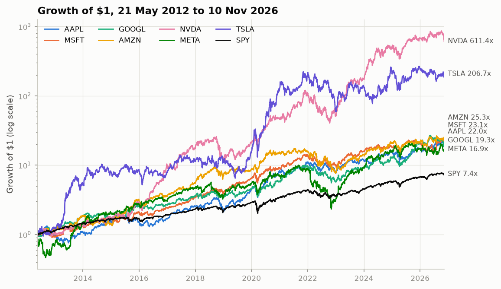

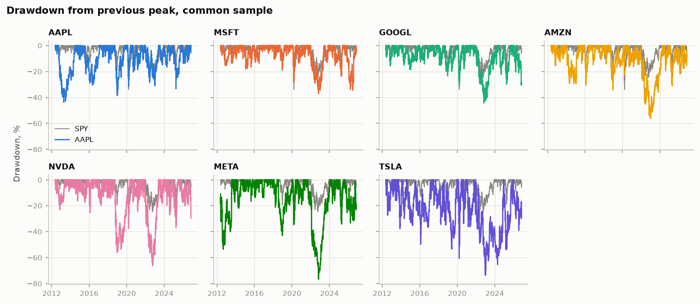

## Correlation structure

### By frequency

Average of the 21 pairwise correlations ([`results/correlation_summary.csv`](results/correlation_summary.csv); every pair at every frequency in [`results/correlation_by_frequency.csv`](results/correlation_by_frequency.csv); full matrices in [`correlation_daily.csv`](results/correlation_daily.csv), [`correlation_weekly.csv`](results/correlation_weekly.csv), [`correlation_monthly.csv`](results/correlation_monthly.csv)):

| Frequency | Observations | Average pairwise correlation | Highest pair | Lowest pair |
|---|---:|---:|---|---|
| Daily | 3,640 | 0.46 | GOOGL–AMZN 0.61 | META–TSLA 0.30 |
| Weekly | 755 | 0.42 | GOOGL–AMZN 0.58 | META–TSLA 0.25 |
| Monthly | 173 | 0.40 | GOOGL–AMZN 0.62 | AAPL–META 0.25 |

Correlations are lower at longer horizons. All 21 pairs are lower weekly than daily, and 17 of 21 are lower monthly than daily. The pairs that fall most involve META (AAPL–META 0.41 daily, 0.25 monthly). A likely reason is that part of the daily co-movement is market-wide news and flows that wash out over a month, while company news (results, product cycles) builds up. Sampling error matters at the monthly horizon: with 173 observations, a single correlation of 0.4 has a standard error of roughly 0.06, so individual pair differences are not significant. The consistent direction across pairs is the evidence.

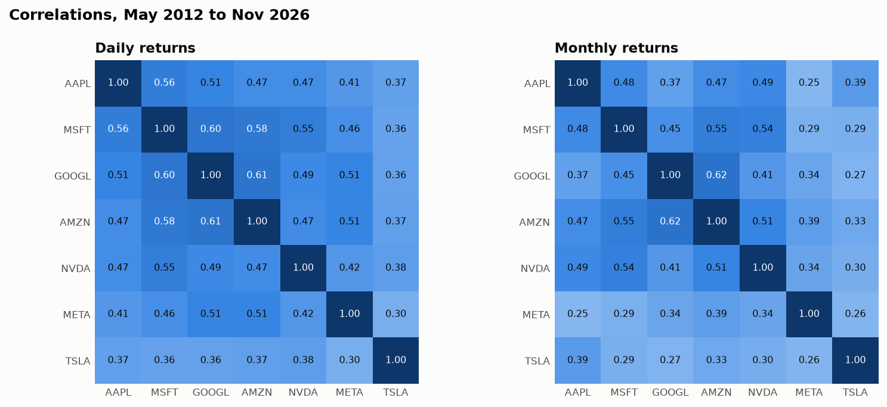

### Over time

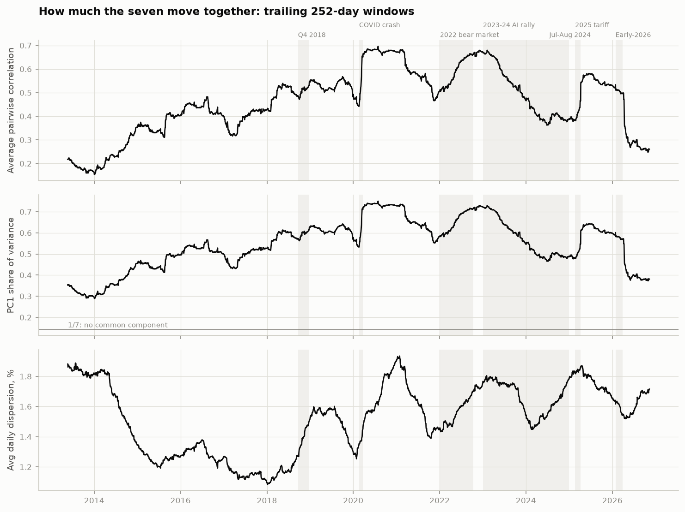

The trailing 252-day average pairwise correlation, the share of variance in the first principal component and the average daily dispersion, sampled at month end ([`results/rolling_correlation_month_end.csv`](results/rolling_correlation_month_end.csv)):

- **The seven were least alike in 2013–14**: average correlation 0.16 at the end of December 2013, with PC1 explaining 30% of standardised variance (1/7 = 14% would mean no common component). They were **most alike after the COVID crash**: 0.68 at the end of July 2020, with PC1 at 74%. The 2022 bear market brought them almost as close (0.68 at the end of November 2022), and the 2025 tariff sell-off to 0.58 (end of May 2025).
- **On 10 November 2026 the average correlation is 0.26 and PC1 explains 38%**, close to the 2013–14 level.
- **The fall from 0.50 (end of March 2026) to 0.31 (end of April 2026) is largely a window effect.** The window ending 31 March 2026 has an average correlation of 0.499. Without the six trading days from 3 to 10 April 2025, the tariff sell-off and the 9 April rebound, it is 0.356. The largest one-day change in the whole series is −0.10 on 13 April 2026, the day 9 April 2025 left the window ([`results/rolling_correlation_jumps.csv`](results/rolling_correlation_jumps.csv)). Equal-weighted rolling windows behave this way; an exponentially weighted estimate would fade such days gradually.
- **Each stock's correlation with SPY** is in the same file. MSFT's one-year correlation with SPY peaked at 0.92 (end of March 2020) and is 0.42 now; AAPL's peaked at 0.90 (end of May 2020) and is 0.33 now.

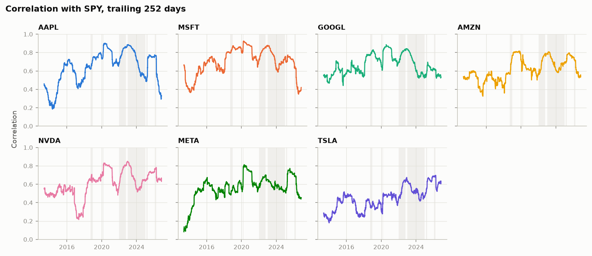

By calendar year ([`results/dispersion_by_year.csv`](results/dispersion_by_year.csv)), the average pairwise correlation was highest in 2022 (0.67) and 2020 (0.67) and lowest in 2013 (0.16) and 2026 to date (0.26). The spread between the best and worst stock of the year was largest in 2020 (TSLA +743%, GOOGL +31%). In 2022 the best of the seven was AAPL, at −26%.

### Calm versus stressed markets

Conditional correlations are biased upwards on volatile days even when nothing about the stocks changes. The common market component is a larger part of each stock's variance on those days (Forbes and Rigobon, 2002). To separate that effect, each row compares the actual average correlation with a benchmark from a one-factor model. The benchmark keeps every stock's full-sample beta to SPY and the full-sample residual covariance, and replaces SPY's variance with its variance on those days ([`results/conditional_correlation.csv`](results/conditional_correlation.csv)):

| Days | Number | SPY daily volatility | Average pairwise correlation | If only SPY's variance changed | Difference |
|---|---:|---:|---:|---:|---:|
| All days | 3,640 | 1.05% | 0.46 | 0.46 | 0.00 |
| SPY up days | 2,009 | 0.73% | 0.31 | 0.34 | −0.02 |
| SPY down days | 1,620 | 0.85% | 0.40 | 0.39 | 0.01 |
| SPY worst 10% of days | 364 | 1.09% | 0.41 | 0.48 | −0.07 |
| SPY middle 80% of days | 2,912 | 0.49% | 0.25 | 0.24 | 0.01 |
| SPY best 10% of days | 364 | 1.01% | 0.39 | 0.45 | −0.06 |

Every subset has a lower correlation than all days together. Splitting the sample by the market's return mechanically truncates the common component. Within that, correlations on down days are higher than on up days (0.40 against 0.31), and on the worst 10% of days higher than on the middle 80% (0.41 against 0.25). Both gaps are explained by SPY's higher volatility on those days: the benchmark predicts as much or more. On this evidence the seven do not "lock together" in sell-offs beyond what the market factor implies.

Exceedance correlations (Longin and Solnik, 2001; Ang and Chen, 2002): each stock's daily returns are standardised, and for each pair the correlation is measured on the days when both are below a threshold (left) or both above it (right). The benchmark is a bivariate normal with each pair's own correlation, simulated ([`results/exceedance_correlation.csv`](results/exceedance_correlation.csv)):

| Threshold (sd) | Mega 7, average of 21 pairs | Normal with same correlations | Joint days per pair |
|---:|---:|---:|---:|
| −1.5 | 0.38 | 0.13 | 73 |
| −1.0 | 0.38 | 0.16 | 184 |
| −0.5 | 0.41 | 0.20 | 469 |
| 0.0 | 0.47 | 0.25 | 1,229 |
| 0.5 | 0.38 | 0.20 | 432 |
| 1.0 | 0.41 | 0.16 | 135 |
| 1.5 | 0.40 | 0.13 | 46 |

The exceedance correlations are about 0.25 above the normal benchmark at every threshold, on both sides. That pattern fits volatility that rises and falls for all seven together (calm and turbulent periods), and not a crash-only effect. The asymmetry is in frequency, not correlation: joint moves below −1.5 sd happen on 73 days per pair, joint moves above +1.5 sd on 46.

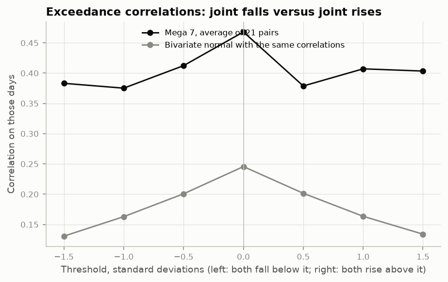

### Clusters and principal components

Hierarchical clustering uses the distance √(2(1 − ρ)) (Mantegna, 1999) and average linkage. It is run on raw daily correlations, and again on the residuals after removing each stock's beta to SPY ([`results/clustering_merges.csv`](results/clustering_merges.csv), [`results/correlation_residual_vs_spy.csv`](results/correlation_residual_vs_spy.csv)):

- **Raw returns**: GOOGL and AMZN join first (correlation 0.61), then MSFT, AAPL, NVDA and META; TSLA joins last.
- **After removing SPY**: GOOGL and AMZN join first (residual correlation 0.33), then META, then MSFT. NVDA, AAPL and TSLA join at residual correlations of 0.13 or less. Beyond the market, the clearest shared component is the three advertising, cloud and consumer-internet businesses.

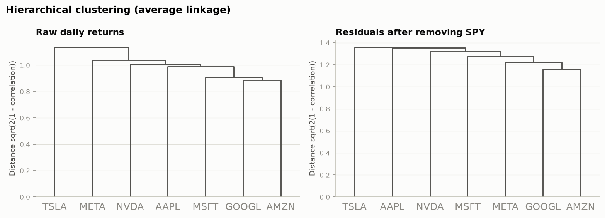

Principal components of the correlation matrix ([`results/pca.csv`](results/pca.csv)). PC1 explains 54.5% of standardised daily variance, 50.5% weekly and 48.9% monthly, with nearly equal loadings on all seven (0.30 for TSLA to 0.41 for MSFT, daily). That is almost exactly what an equicorrelated matrix with the same average correlation would give (54.0%, 50.1%, 48.2%), so PC1 here is essentially "the average correlation". PC2 explains 10.8% daily, and is mostly Tesla against the rest (TSLA's daily loading 0.88).

### Episodes

Each sell-off is located by one date inside it. Its window is SPY's peak-to-trough drawdown that contains that date, read from the data, starting on the first day after the peak. The 2023–24 rally is the two calendar years. Returns are compound over the window. "Mega 7 (EW)" is the average of the seven returns, an equal-weight basket bought at the start. "Avg corr" is the average pairwise daily correlation inside the window, reported for windows of 15 days or more ([`results/episodes.csv`](results/episodes.csv), which also has PC1 shares and dispersion):

| Episode | Window | AAPL | MSFT | GOOGL | AMZN | NVDA | META | TSLA | SPY | QQQ | RSP | Mega 7 (EW) | Worse than SPY | Avg corr |
|---|---|---:|---:|---:|---:|---:|---:|---:|---:|---:|---:|---:|---:|---:|
| Q4 2018 sell-off | 21 Sep – 24 Dec 2018 (65 days) | −33.0% | −16.8% | −17.4% | −30.9% | −52.2% | −25.3% | −1.0% | −19.3% | −22.0% | −19.7% | −25.2% | 4 of 7 | 0.59 |
| COVID crash | 20 Feb – 23 Mar 2020 (23 days) | −30.7% | −27.4% | −30.9% | −12.3% | −32.4% | −31.9% | −52.7% | −33.7% | −27.9% | −39.0% | −31.2% | 1 of 7 | 0.84 |
| 2022 bear market | 4 Jan – 12 Oct 2022 (195 days) | −23.7% | −32.1% | −32.7% | −33.7% | −61.8% | −62.3% | −45.7% | −24.5% | −34.3% | −20.3% | −41.7% | 6 of 7 | 0.70 |
| 2023–24 AI rally | 3 Jan 2023 – 31 Dec 2024 (502 days) | +95% | +79% | +115% | +161% | +820% | +388% | +228% | +58% | +94% | +28% | +269% | 0 of 7 | 0.42 |
| Jul–Aug 2024 sell-off | 17 Jul – 5 Aug 2024 (14 days) | −10.9% | −12.1% | −13.4% | −16.6% | −20.5% | −2.9% | −22.5% | −8.4% | −12.3% | −5.2% | −14.1% | 6 of 7 | n/a |
| 2025 tariff sell-off | 20 Feb – 8 Apr 2025 (34 days) | −29.6% | −14.3% | −21.8% | −24.7% | −30.8% | −27.4% | −38.5% | −18.8% | −22.8% | −16.0% | −26.7% | 6 of 7 | 0.70 |
| Early-2026 drawdown | 28 Jan – 30 Mar 2026 (43 days) | −4.4% | −25.1% | −18.2% | −17.9% | −12.4% | −20.2% | −17.5% | −8.9% | −11.4% | −5.1% | −16.5% | 6 of 7 | 0.28 |

- **The COVID crash was the most "one trade" episode** (average correlation 0.84). It is also the only sell-off in which the seven, on average, lost less than SPY, and much less than the equal-weight index (RSP −39.0%).
- **In 2022, 2024, 2025 and 2026 the seven fell more than the index,** and the equal-weight index fell least. In 2022 the basket lost 41.7% while RSP lost 20.3%.
- **The early-2026 drawdown was a sell-off with low correlation among the seven (0.28).** MSFT fell 25.1% while AAPL fell 4.4%. I have not attributed it to a cause; the table only reports what the prices did.
- **In the 2023–24 rally all seven beat SPY**, from MSFT (+79%) to NVDA (+820%), at an average correlation of 0.42.

Single days ([`results/episode_days.csv`](results/episode_days.csv)). The causes in brackets are the widely reported ones; the numbers are from the data:

| Day | AAPL | MSFT | GOOGL | AMZN | NVDA | META | TSLA | SPY | QQQ | RSP | Down > 5% | Up |
|---|---:|---:|---:|---:|---:|---:|---:|---:|---:|---:|---:|---:|
| 16 Mar 2020 (SPY's worst day in the sample) | −12.9% | −14.7% | −11.6% | −5.4% | −18.5% | −14.3% | −18.6% | −10.9% | −12.0% | −12.0% | 7 | 0 |
| 3 Feb 2022 (META's results) | −1.7% | −3.9% | −3.3% | −7.8% | −5.1% | −26.4% | −1.6% | −2.4% | −4.1% | −1.3% | 3 | 0 |
| 25 May 2023 (NVDA's results and guidance) | 0.7% | 3.8% | 2.1% | −1.5% | 24.4% | 1.4% | 0.9% | 0.9% | 2.4% | −0.1% | 0 | 6 |
| 11 Jul 2024 (rotation: RSP up, the seven down) | −2.3% | −2.5% | −2.9% | −2.4% | −5.6% | −4.1% | −8.4% | −0.9% | −2.2% | 1.2% | 2 | 0 |
| 5 Aug 2024 (low of the summer sell-off) | −4.8% | −3.3% | −4.4% | −4.1% | −6.4% | −2.5% | −4.2% | −2.9% | −3.0% | −2.4% | 1 | 0 |
| 27 Jan 2025 (DeepSeek) | 3.2% | −2.1% | −4.2% | 0.2% | −17.0% | 1.9% | −2.3% | −1.4% | −2.9% | 0.1% | 1 | 3 |
| 4 Apr 2025 (tariffs, second day) | −7.3% | −3.6% | −3.4% | −4.2% | −7.4% | −5.1% | −10.4% | −5.9% | −6.2% | −5.6% | 4 | 0 |
| 9 Apr 2025 (tariff pause; SPY's best day) | 15.3% | 10.1% | 9.7% | 12.0% | 18.7% | 14.8% | 22.7% | 10.5% | 12.0% | 8.0% | 0 | 7 |

## Factor decomposition

Monthly excess returns are regressed on the Fama–French five factors and momentum, from June 2012 to September 2026 (172 months). The t-statistics use Newey–West standard errors with floor(4 (T/100)^(2/9)) = 4 lags. Alpha is annualised (× 12) ([`results/factor_regressions.csv`](results/factor_regressions.csv), which also has every t-statistic, the CAPM regressions and the full-history regressions):

| Ticker | Alpha a year (t) | Mkt-RF | SMB | HML | RMW | CMA | Mom | R² |
|---|---:|---:|---:|---:|---:|---:|---:|---:|
| AAPL | 6.8% (1.3) | 1.12 | −0.15 | −0.45 | 0.60 | −0.24 | −0.04 | 0.46 |
| MSFT | 8.9% (2.1) | 0.96 | −0.76 | −0.36 | 0.27 | −0.22 | −0.30 | 0.54 |
| GOOGL | 8.3% (1.7) | 1.04 | −0.38 | 0.22 | 0.11 | −1.10 | 0.15 | 0.46 |
| AMZN | 7.5% (1.5) | 1.25 | −0.27 | −0.53 | 0.03 | −0.86 | −0.04 | 0.56 |
| NVDA | 31.8% (2.8) | 1.61 | −0.19 | −0.64 | 0.39 | −0.81 | −0.01 | 0.42 |
| META | 12.5% (1.5) | 1.14 | −0.46 | −0.67 | 0.01 | 0.04 | −0.23 | 0.24 |
| TSLA | 34.9% (2.4) | 1.53 | 0.45 | −0.93 | −0.96 | −0.85 | −0.43 | 0.27 |
| Mega 7 EW | 15.8% (4.2) | 1.23 | −0.25 | −0.48 | 0.06 | −0.58 | −0.13 | 0.75 |
| SPY | −0.1% (−0.5) | 0.99 | −0.11 | 0.02 | 0.05 | 0.02 | 0.00 | 1.00 |
| QQQ | 2.9% (2.1) | 1.11 | −0.24 | −0.27 | −0.15 | −0.19 | 0.01 | 0.92 |
| RSP | −1.1% (−1.4) | 0.96 | 0.16 | 0.16 | 0.12 | 0.13 | −0.06 | 0.96 |

- **SPY is a check on the data:** market beta 0.99, R² 1.00 and alpha −0.1% a year. RSP's positive SMB, HML, RMW and CMA loadings are what equal weighting should produce.
- **The seven are high-beta growth stocks.** Every one has a negative HML loading except GOOGL (0.22). GOOGL, AMZN, NVDA and TSLA load strongly negatively on CMA (−0.81 to −1.10): they invest aggressively. AAPL has the largest profitability loading (RMW 0.60, t = 2.6). TSLA is the outlier: the only negative profitability loading (−0.96) and the most negative momentum loading (−0.43).
- **Over each stock's own history, alphas are larger and more significant**: from 13.4% a year (GOOGL, t = 2.4) to 38.1% (NVDA, t = 3.5); META's is the same as above. See finding 9: this is what selecting winners afterwards produces.

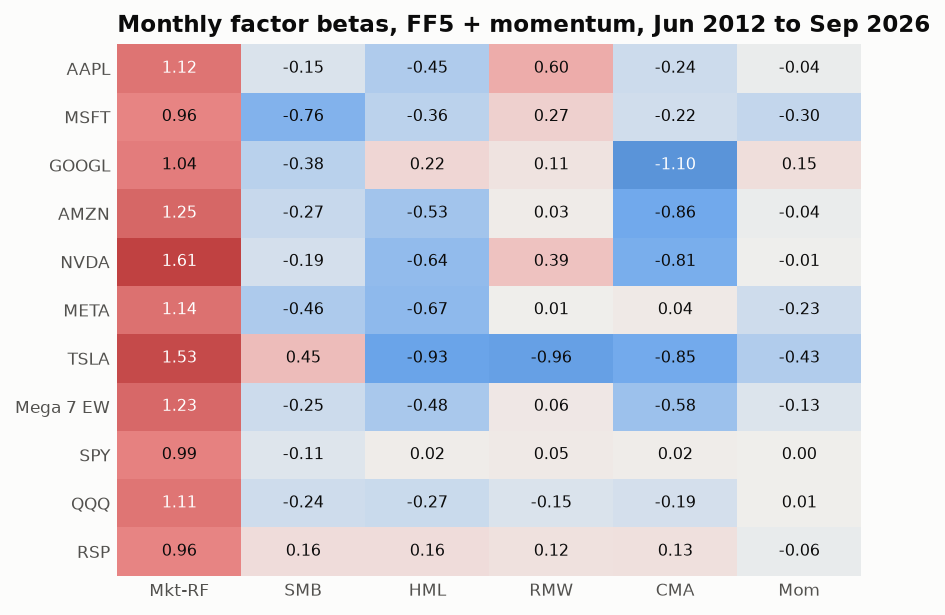

**Systematic versus idiosyncratic variance.** R² splits each stock's variance into a part the factors explain and a residual. The systematic part is split across factors as b_k (Σ_f b)_k, which adds up to R² ([`results/factor_variance_decomposition.csv`](results/factor_variance_decomposition.csv)):

| Ticker | R² monthly | Market | HML | CMA | Other factors | Idiosyncratic | R² daily |
|---|---:|---:|---:|---:|---:|---:|---:|
| AAPL | 0.46 | 37% | 5% | 2% | 2% | 54% | 0.52 |
| MSFT | 0.54 | 35% | 5% | 2% | 10% | 46% | 0.62 |
| GOOGL | 0.46 | 35% | −2% | 13% | −1% | 54% | 0.53 |
| AMZN | 0.56 | 38% | 8% | 11% | 0% | 44% | 0.51 |
| NVDA | 0.42 | 32% | 5% | 6% | 0% | 58% | 0.49 |
| META | 0.24 | 19% | 5% | 0% | 1% | 76% | 0.35 |
| TSLA | 0.27 | 15% | 4% | 3% | 5% | 73% | 0.29 |
| Mega 7 EW | 0.75 | 56% | 9% | 9% | 1% | 25% | 0.80 |

Between 44% and 76% of a single stock's monthly variance is idiosyncratic. In an equal-weight basket that falls to 25%.

**Over time.** Rolling one-year regressions on daily factors, sampled at month end ([`results/rolling_factor_month_end.csv`](results/rolling_factor_month_end.csv)). The basket's R² rose from 0.59 (May 2013) to 0.82 (September 2026), with a high of 0.92. For single stocks the systematic share moves a lot: MSFT ranged from 0.22 to 0.91 and META from 0.07 to 0.75.

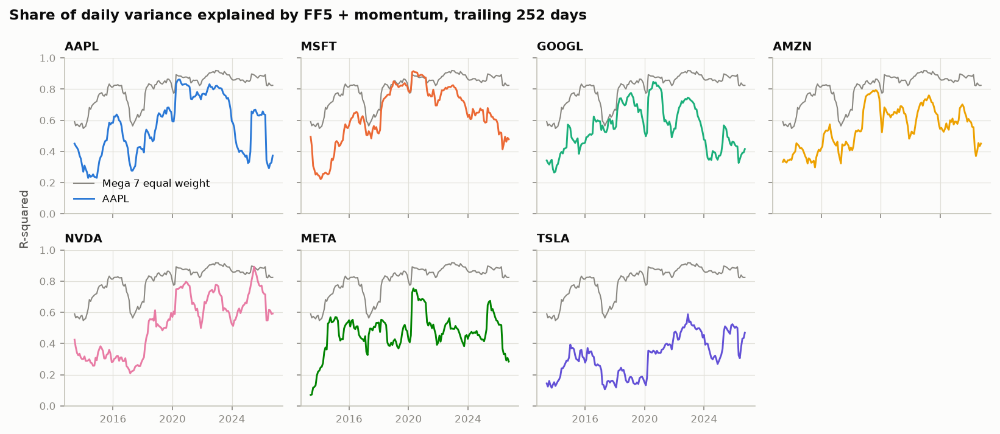

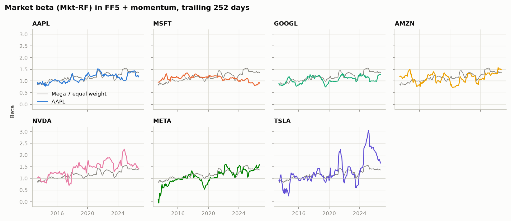

**What the factors leave behind.** After the six factors are removed, the daily residuals of the seven have an average pairwise correlation of 0.04, against 0.47 for raw returns over the same days. PC1 of the residual correlation matrix explains 20%, against 1/7 = 14% for no common component ([`results/factor_notes.txt`](results/factor_notes.txt)). The only material residual correlations are GOOGL–AMZN (0.20), GOOGL–META (0.16) and AMZN–META (0.16) ([`results/residual_correlation_ff6.csv`](results/residual_correlation_ff6.csv)). One caveat makes these factors fit better than they otherwise would. The Ken French factors are built from all US stocks, value-weighted, so these seven are a large part of the market factor and of the big-growth and big-aggressive legs of HML and CMA. Some of the explanatory power is the seven explaining themselves.

## The seven as a portfolio and in the index

### Equal-weight Mega 7 against the index funds

Common sample, daily, no costs ([`results/portfolio_vs_index.csv`](results/portfolio_vs_index.csv)). "Monthly rebalance" resets to 1/7 at each month end and lets the weights drift within the month. Tracking error and information ratio are against SPY:

| Portfolio | Ann. return | Volatility | Sharpe | Sortino | Max drawdown | Peak → trough | Recovered | Beta to SPY | Tracking error | Information ratio | Up / down capture |
|---|---:|---:|---:|---:|---:|---|---|---:|---:|---:|---:|
| Mega 7 EW (monthly rebalance) | 35.6% | 26.6% | 1.21 | 1.76 | 48.9% | 19 Nov 2021 → 28 Dec 2022 | 5 Jul 2023 | 1.32 | 16.0% | 1.17 | 1.90 / 1.04 |
| Mega 7 EW (daily rebalance) | 35.5% | 26.6% | 1.21 | 1.76 | 49.4% | 19 Nov 2021 → 28 Dec 2022 | 13 Jul 2023 | 1.32 | 15.9% | 1.17 | 1.88 / 1.03 |
| Mega 7 buy and hold from 21 May 2012 | 40.2% | 36.0% | 1.07 | 1.56 | 62.7% | 4 Nov 2021 → 27 Dec 2022 | 19 Jan 2024 | 1.53 | 26.9% | 0.93 | 2.23 / 1.12 |
| SPY | 14.9% | 16.6% | 0.81 | 1.15 | 33.7% | 19 Feb 2020 → 23 Mar 2020 | 10 Aug 2020 | n/a | n/a | n/a | n/a |
| QQQ | 19.1% | 20.8% | 0.87 | 1.23 | 35.1% | 27 Dec 2021 → 3 Nov 2022 | 13 Dec 2023 | 1.16 | 8.1% | 0.55 | 1.21 / 1.05 |
| RSP | 13.2% | 17.0% | 0.71 | 1.00 | 39.0% | 12 Feb 2020 → 23 Mar 2020 | 9 Nov 2020 | 0.96 | 5.7% | −0.25 | 0.94 / 1.02 |

The monthly-rebalanced basket trades 34% of its value a year (one-way). Buy and hold earns more, because it lets Nvidia and Tesla grow to 66% and 22% of the portfolio ([`results/buy_and_hold_weights.csv`](results/buy_and_hold_weights.csv)). That higher return comes with a 62.7% drawdown and a lower Sharpe ratio.

Calendar years ([`results/portfolio_calendar_years.csv`](results/portfolio_calendar_years.csv)):

| Year | Mega 7 EW | SPY | QQQ | RSP | SPY − RSP |
|---|---:|---:|---:|---:|---:|
| 2012 (from 21 May) | 4.8% | 11.7% | 8.3% | 14.7% | −3.0% |
| 2013 | 86.9% | 32.3% | 36.6% | 35.5% | −3.2% |
| 2014 | 22.7% | 13.5% | 19.2% | 14.1% | −0.6% |
| 2015 | 41.1% | 1.2% | 9.4% | −2.7% | 3.9% |
| 2016 | 28.1% | 12.0% | 7.1% | 14.5% | −2.5% |
| 2017 | 53.2% | 21.7% | 32.7% | 18.5% | 3.2% |
| 2018 | 0.7% | −4.6% | −0.1% | −7.8% | 3.3% |
| 2019 | 53.1% | 31.2% | 39.0% | 28.9% | 2.3% |
| 2020 | 116.5% | 18.3% | 48.4% | 12.7% | 5.7% |
| 2021 | 50.3% | 28.7% | 27.4% | 29.4% | −0.7% |
| 2022 | −45.1% | −18.2% | −32.6% | −11.6% | −6.6% |
| 2023 | 108.3% | 26.2% | 54.9% | 13.7% | 12.5% |
| 2024 | 60.9% | 24.9% | 25.6% | 12.8% | 12.1% |
| 2025 | 25.4% | 17.7% | 20.8% | 11.2% | 6.5% |
| 2026 (to 10 Nov) | 6.0% | 10.8% | 10.2% | 16.7% | −5.9% |

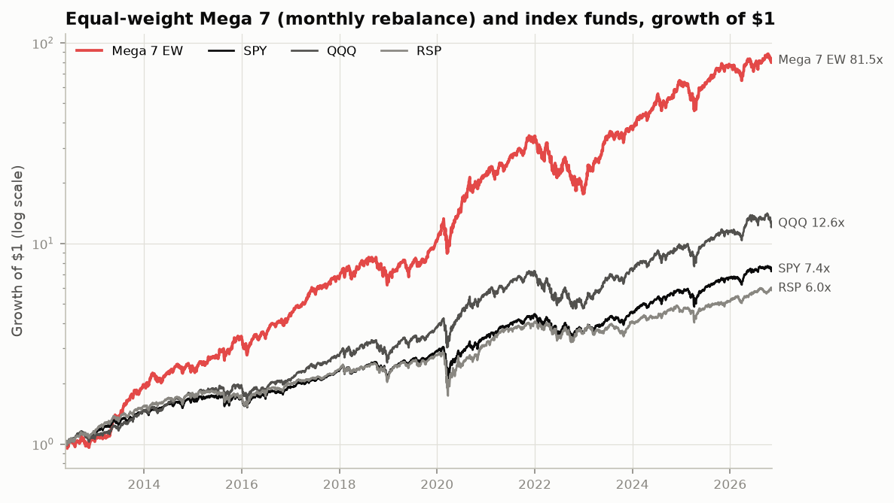

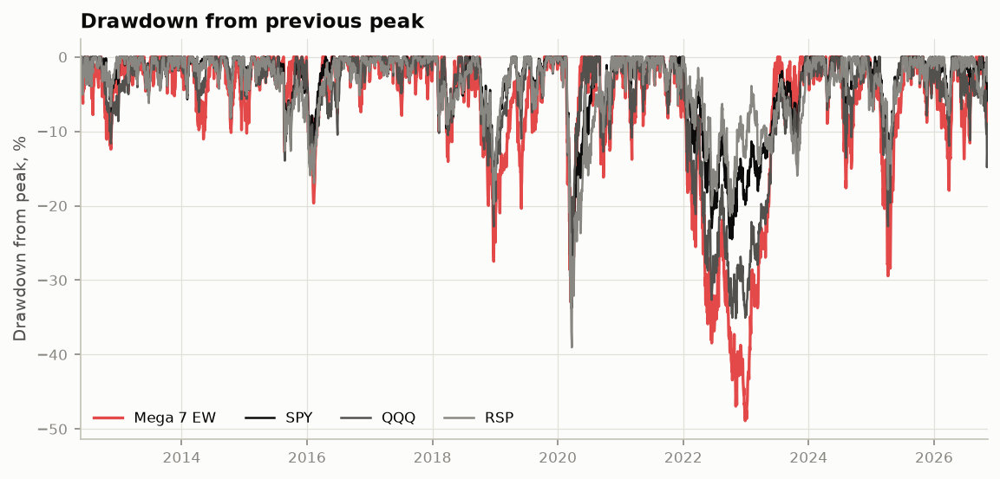

### Who carries the risk

Each stock's contribution to the volatility of the basket. The marginal contribution is ∂σ_p/∂w_i = (Σw)_i/σ_p, and the component contribution w_i (Σw)_i/σ_p; components add up to the portfolio volatility, and a test checks this. The diversification ratio is the weighted average of the stocks' volatilities over the portfolio's ([`results/risk_contributions.csv`](results/risk_contributions.csv), [`results/diversification.csv`](results/diversification.csv)). The last two columns weight the seven by their **current** market caps on 11 November 2026 and use the covariance of the last 252 days. Current caps are not combined with the 14-year covariance, because that would mix two different times.

| Ticker | Volatility (full sample) | Share of risk, equal weight, full sample | Volatility (last year) | Share of risk, equal weight, last year | Current cap weight | Share of risk, current cap weight, last year |
|---|---:|---:|---:|---:|---:|---:|
| AAPL | 28.2% | 10.6% | 24.9% | 5.2% | 22.3% | 11.6% |
| MSFT | 26.7% | 10.8% | 33.9% | 11.9% | 17.4% | 17.8% |
| GOOGL | 28.0% | 11.3% | 33.7% | 13.9% | 15.6% | 16.6% |
| AMZN | 32.4% | 13.1% | 34.0% | 15.6% | 12.9% | 15.1% |
| NVDA | 44.9% | 18.1% | 38.9% | 15.2% | 18.0% | 21.8% |
| META | 40.0% | 15.0% | 41.6% | 17.3% | 7.2% | 8.1% |
| TSLA | 57.0% | 21.0% | 45.9% | 20.8% | 6.6% | 9.1% |

| Weights | Covariance | Portfolio volatility | Weighted average stock volatility | Diversification ratio |
|---|---|---:|---:|---:|
| Equal | Full sample | 26.6% | 36.7% | 1.38 |
| Equal | Last 252 days | 22.3% | 36.1% | 1.62 |
| Current market caps | Last 252 days | 20.4% | 34.1% | 1.67 |

- **Equal weights do not mean equal risk.** Over the full sample TSLA carries 21.0% of the basket's volatility and AAPL 10.6%. Over the last year AAPL carries only 5.2%: its volatility is the lowest of the seven, and its correlation with the others has fallen.
- **Diversification within the seven changes with their correlation.** On a trailing one-year covariance, the diversification ratio ranged from 1.19 (end of November 2022) to 1.90 (end of September 2013), and is 1.62 now. At month ends TSLA's share of risk peaked at 36% (February 2014) and NVDA's at 32% (September 2017) ([`results/rolling_risk_month_end.csv`](results/rolling_risk_month_end.csv)).

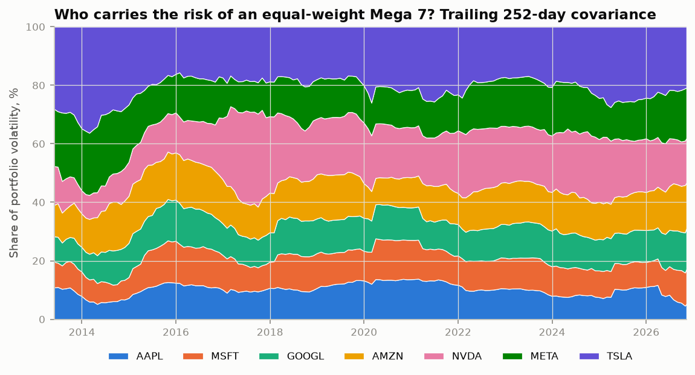

### Concentration in the index: SPY minus RSP

SPY weights the S&P 500 by market cap; RSP weights the same stocks equally. Their return difference is a proxy for how much the largest stocks drive the index. The data hold no historical index weights, so the seven's weight in the S&P 500 is not measured here. Two statistics are used instead ([`results/concentration_month_end.csv`](results/concentration_month_end.csv), [`results/concentration_regression.csv`](results/concentration_regression.csv)):

- **The share of each index's daily variance explained by the equal-weight seven** (R² over the trailing 252 days). For SPY it was 0.33 at the end of 2013, 0.73 at the end of 2018, 0.84 at the end of 2022, 0.83 at the end of 2025 and 0.71 on 10 November 2026. For RSP it is 0.22 now, after 0.71 at the end of 2022: since 2023 the seven have explained much less of the equal-weighted index than of the cap-weighted one.
- **A monthly regression of SPY − RSP on (Mega 7 EW − RSP)**, June 2012 to October 2026: slope 0.19 (t = 7.6), R² 0.46. The intercept is −2.4% a year (t = −2.5): apart from the seven's effect, cap weighting trailed equal weighting. RSP's tilt to smaller and cheaper stocks (its SMB and HML loadings above) is one explanation. Fees and RSP's rebalancing also enter the gap. The same regression on QQQ − RSP has a slope of 0.40 and R² 0.76.

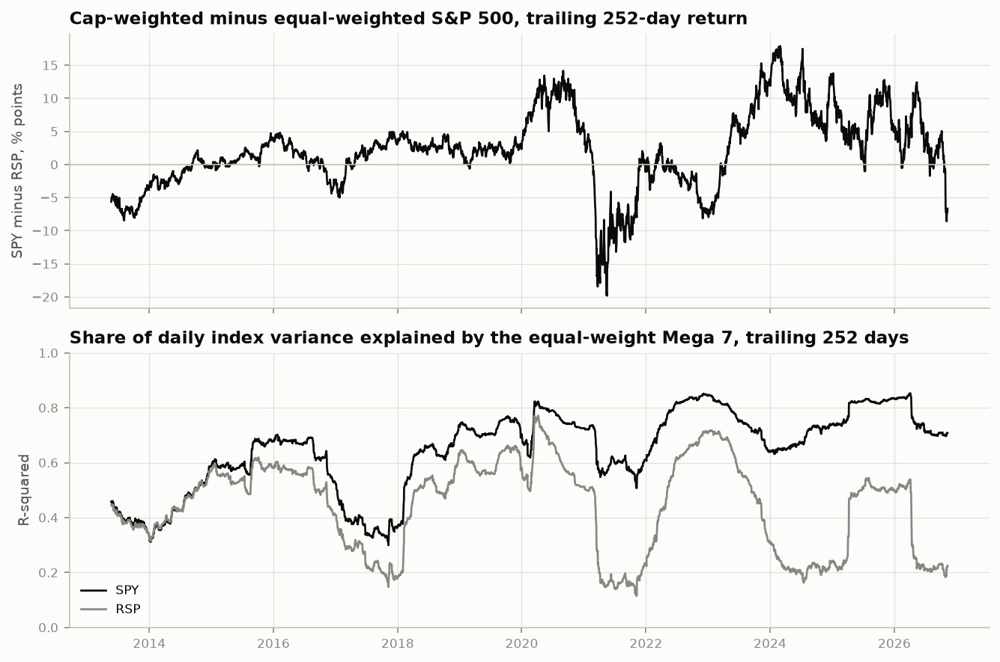

## Tail co-movement

How often several of the seven move more than 5% on the same day. The day counts are SQL queries on the daily panel (`PriceStore.joint_move_counts`), checked against pandas in the script. They are compared with two benchmarks that keep each stock's own frequency of 5% moves. The first assumes independent stocks (the count is then Poisson-binomial, computed exactly). The second is a Gaussian copula with the observed rank (normal-score) correlations, simulated with a million draws ([`results/joint_moves_vs_benchmarks.csv`](results/joint_moves_vs_benchmarks.csv), [`results/joint_moves_distribution.csv`](results/joint_moves_distribution.csv)):

| Move | At least k of 7 | Observed days | Gaussian copula | Independent | Observed / copula |
|---|---:|---:|---:|---:|---:|
| Fall > 5% | 1 | 352 | 385.4 | 486.9 | 0.91 |
| Fall > 5% | 2 | 90 | 86.3 | 26.3 | 1.04 |
| Fall > 5% | 3 | 35 | 27.2 | 0.72 | 1.28 |
| Fall > 5% | 4 | 20 | 10.0 | 0.01 | 2.00 |
| Fall > 5% | 5 | 10 | 3.5 | 0.00 | 2.90 |
| Rise > 5% | 1 | 461 | 451.1 | 572.3 | 1.02 |
| Rise > 5% | 2 | 83 | 106.6 | 36.5 | 0.78 |
| Rise > 5% | 3 | 29 | 35.0 | 1.2 | 0.83 |
| Rise > 5% | 4 | 15 | 12.9 | 0.02 | 1.17 |
| Rise > 5% | 5 | 11 | 4.8 | 0.00 | 2.31 |

- **Independence is far off.** It would almost never see three of the seven fall 5% on one day; it happened on 35 days.
- **A Gaussian copula matches the moderate cases and misses the extreme ones.** Days with five or more falls of 5% are 2.9 times as frequent as the copula predicts. The same holds at 3% and 7% thresholds (2.2 and 2.9 times at five or more).
- **Extreme joint rises also exceed the copula** (2.3 times at five or more), mostly rebound days such as 9 April 2025. The tail dependence is on both sides, as the exceedance correlations showed.
- **Joint crashes come in clusters of time.** The 35 days with at least three falls of 5% include 13 in 2022, 10 in 2020 and 4 in 2018. There are none in 2012 (from 21 May), 2013, 2014, 2017, 2021 or 2023 ([`results/joint_crashes_by_year.csv`](results/joint_crashes_by_year.csv); the dates and which stocks fell are in [`results/joint_crash_days.csv`](results/joint_crash_days.csv)).
- **Conditional crash probabilities** are in [`results/co_crash_matrix.csv`](results/co_crash_matrix.csv). For example, on the 31 days AAPL fell more than 5%, NVDA did too on 55% of them. TSLA fell more than 5% on 197 days and NVDA on 112, against 20 for MSFT.

Two caveats. The copula is fitted in-sample to the same data, and counts of 10 or 20 days are small, so the ratios are rough. The benchmark is still useful: it shows that ordinary correlation, even when measured robustly, understates how often the seven crash together.

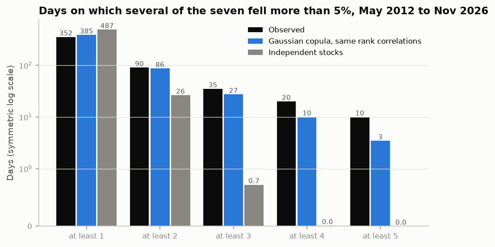

## Event study: Nvidia, November 2026

From its highest close, on 6 October 2026, to 10 November 2026, Nvidia fell 29.4% while SPY fell 3.7% ([`results/event_study_windows.csv`](results/event_study_windows.csv)). This section splits each day of the fall into a market part, a semiconductor-sector part, alpha and a company-specific part, and compares the result with the DeepSeek day, 27 January 2025.

**What was reported.** Only what the cited sources say:

- **4 and 5 November 2026.** Chip and AI stocks sold off ([Yahoo Finance, live coverage of 5 November](https://finance.yahoo.com/markets/live/stock-market-today-thursday-november-5-dow-sp-500-nasdaq-plunge-chip-stocks-melt-down-193726491.html)). On 5 November SPY fell 4.4% and SMH, a semiconductor ETF, 11.2%.
- **8 November, a Sunday.** Nvidia's board said it was opening an independent investigation, overseen by a committee of independent directors with outside counsel, after reports that the company's chief executive had been the target of a foreign intelligence effort. The board said it had no reason to believe that national security or Nvidia's secrets had been compromised ([statement from Nvidia's board](https://nvidianews.nvidia.com/news/statement-from-nvidia-board-of-directors); [CNBC, 8 November 2026](https://www.cnbc.com/2026/11/08/nvidia-jensen-huang-investigation-china-spy.html)).
- **9 November** was the first trading day after the statement.

**Model.** NVDA's daily return r is regressed on SPY's return m and on the sector's return orthogonalised to SPY:

```
r = alpha + beta_m m + beta_s s* + e,      s* = s - (a + b m)
```

Here a and b come from a regression of the sector return s on m over the same estimation window, so s* is the sector's move beyond what SPY implies. A day's return splits into four parts that add up to it exactly: market (beta_m m), sector (beta_s s*), alpha, and the company-specific or abnormal part e. Because s* is uncorrelated with SPY inside the estimation window, alpha and beta_m equal the one-factor market model's, and the one-factor abnormal return splits exactly into the sector part and the company-specific part. The z-score is the abnormal return over the residual standard deviation σ of the estimation window, and for a window of L days the cumulative abnormal return over σ√L. It ignores estimation error and says nothing about the shape of the tails, so it is a scale, not a probability.

- **Estimation windows.** One rule for both events: 250 trading days ending 21 trading days before the first day of the event window. For November 2026 (first day 4 November) that is 8 October 2025 to 6 October 2026. It ends on the day of the peak, so even the window that starts at the peak does not overlap it. For DeepSeek (27 January 2025) it is 27 December 2023 to 23 December 2024.
- **Sector factor.** The primary specification uses SMH, the VanEck Semiconductor ETF. SMH holds Nvidia, its largest holding in Yahoo Finance's holdings data on 11 November 2026, so when Nvidia falls on its own news SMH falls with it, and part of Nvidia's own move is counted as sector. The robustness check uses instead an equal-weight basket of eight large semiconductor stocks without Nvidia (AVGO, AMD, TSM, MU, QCOM, ASML, INTC, TXN), rebalanced daily. All eight trade throughout both estimation windows.
- **The other six of the seven** get a one-factor SPY model on the same estimation windows.

Coefficients ([`results/event_study_estimation.csv`](results/event_study_estimation.csv)):

| Estimation window | Beta to SPY | Sector beta: SMH | Sector beta: peers | SMH's beta to SPY | Alpha a day | Residual sd a day (SMH model) | R² (SMH model) |
|---|---:|---:|---:|---:|---:|---:|---:|
| 8 Oct 2025 – 6 Oct 2026 | 1.89 | 0.43 | 0.15 | 2.36 | 0.00% | 1.68% | 0.51 |
| 27 Dec 2023 – 23 Dec 2024 | 2.70 | 1.36 | 0.76 | 2.21 | 0.21% | 1.76% | 0.72 |

**Each day** ([`results/event_study_days.csv`](results/event_study_days.csv)). Returns are in percent and the parts in percentage points; z is in brackets. "One-factor abnormal" is the abnormal return of a model with SPY alone, which equals the sector part plus the company-specific part. The last two columns repeat the split with the peer basket; the market part and alpha are the same with either sector factor.

| Day | NVDA | SPY | SMH | Market | Sector beyond SPY | Alpha | Company-specific (z) | One-factor abnormal | Peer basket: sector | Peer basket: company-specific (z) |
|---|---:|---:|---:|---:|---:|---:|---:|---:|---:|---:|
| 4 Nov 2026 | −3.2% | +1.7% | −2.7% | +3.1 | −2.9 | 0.0 | −3.4 (−2.0) | −6.3 | −0.9 | −5.4 (−3.0) |
| 5 Nov 2026 | −9.3% | −4.4% | −11.2% | −8.3 | −0.4 | 0.0 | −0.6 (−0.3) | −1.0 | −0.2 | −0.7 (−0.4) |
| 6 Nov 2026 | +2.8% | +0.3% | +3.6% | +0.6 | +1.2 | 0.0 | +1.0 (+0.6) | +2.2 | +0.6 | +1.5 (+0.9) |
| 9 Nov 2026 | −4.3% | +2.4% | +5.1% | +4.5 | −0.3 | 0.0 | −8.4 (−5.0) | −8.7 | +0.1 | −8.9 (−4.9) |
| 10 Nov 2026 | −5.5% | −0.4% | −0.8% | −0.7 | 0.0 | 0.0 | −4.8 (−2.8) | −4.8 | +0.2 | −5.0 (−2.8) |
| 27 Jan 2025 | −17.0% | −1.4% | −9.8% | −3.8 | −9.1 | +0.2 | −4.3 (−2.4) | −13.4 | −3.0 | −10.3 (−4.4) |
| 28 Jan 2025 | +8.9% | +0.9% | +2.0% | +2.3 | +0.2 | +0.2 | +6.2 (+3.6) | +6.4 | −1.5 | +7.9 (+3.4) |

**Windows** ([`results/event_study_windows.csv`](results/event_study_windows.csv)). Each part is the sum of its daily values, and z is the cumulative abnormal return over σ√L. The parts add up to the sum of the daily returns. "Compounding" is the compound return minus that sum, so the parts plus compounding give the compound return.

| Window | Days | NVDA, compound | SPY, compound | Market | Sector beyond SPY | Alpha | Company-specific (z) | Compounding | Peer basket: sector | Peer basket: company-specific (z) |
|---|---:|---:|---:|---:|---:|---:|---:|---:|---:|---:|
| 9–10 Nov 2026 (after the board's statement) | 2 | −9.5% | +2.0% | +3.8 | −0.3 | 0.0 | −13.2 (−5.6) | +0.2 | +0.4 | −13.9 (−5.5) |
| 4–10 Nov 2026 | 5 | −18.3% | −0.6% | −0.8 | −2.4 | 0.0 | −16.1 (−4.3) | +1.1 | −0.1 | −18.5 (−4.6) |
| 6 Oct 2026 peak to 10 Nov 2026 | 25 | −29.4% | −3.7% | −6.8 | −8.5 | +0.1 | −18.3 (−2.2) | +4.2 | −2.4 | −24.4 (−2.7) |
| 27 Jan 2025 | 1 | −17.0% | −1.4% | −3.8 | −9.1 | +0.2 | −4.3 (−2.4) | 0.0 | −3.0 | −10.3 (−4.4) |
| 27–28 Jan 2025 | 2 | −9.6% | −0.6% | −1.5 | −8.9 | +0.4 | +1.9 (+0.8) | −1.5 | −4.6 | −2.4 (−0.7) |

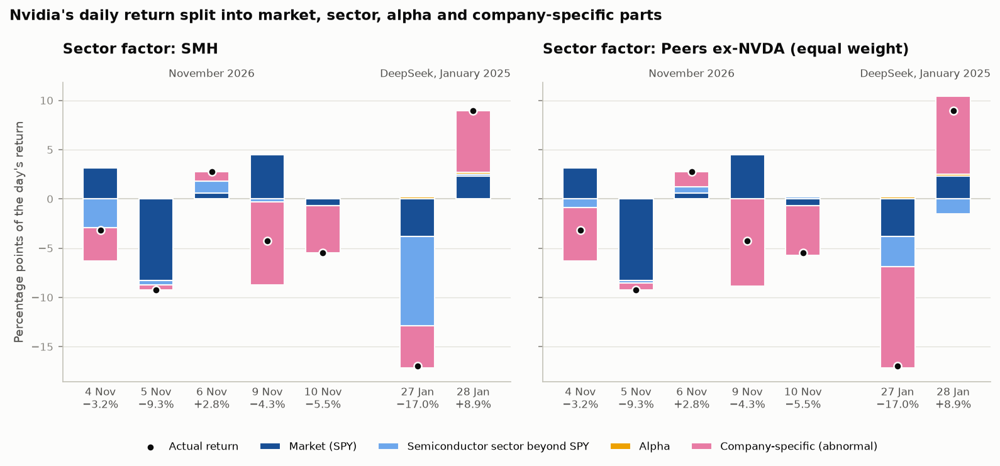

- **The headline day, 5 November (−9.3%), was a market and sector day.** SPY fell 4.4%, and at Nvidia's beta of 1.89 that accounts for −8.3 points. SMH fell 11.2%, but its own beta to SPY was 2.36, so most of its fall is what SPY's fall implies, and the sector's move beyond SPY added only −0.4 points. Nvidia's own part was −0.6% (z −0.3), an ordinary day for Nvidia given what the market did. The model counts everything that moves with SPY as market, and SPY itself holds Nvidia and the other chipmakers, so on a day when chip and AI stocks sold off the market part is not independent of the sector.
- **The investigation day looked small but was a large company-specific move.** On 9 November NVDA fell 4.3% while SPY rose 2.4% and SMH 5.1%. At a beta of 1.89 the market alone implied +4.5 points. The company-specific part was −8.4% (z −5.0) with SMH as the sector factor and −8.9% (z −4.9) with the peer basket. With SMH the sector part is slightly negative (−0.3 points) although SMH rose, because SMH rose less than its beta to SPY implies; SMH holds Nvidia. With the peer basket, which does not, it is +0.1. Over 9 and 10 November together the company-specific parts add up to −13.2% (z −5.6) with SMH and −13.9% (z −5.5) with the peers, while NVDA fell 9.5% and SPY rose 2.0%.
- **The rest of the seven did not move with Nvidia on 9 November.** In the one-factor model the other six had abnormal returns between −2.1% (GOOGL) and +1.7% (META); the largest z-score among them was GOOGL's −1.2. Nvidia's was −8.7% (z −4.8) ([`results/event_study_megacaps.csv`](results/event_study_megacaps.csv)):

| Ticker | 9 Nov 2026: return | Beta | Abnormal (z) | 27 Jan 2025: return | Beta | Abnormal (z) |
|---|---:|---:|---:|---:|---:|---:|
| AAPL | +2.4% | 0.69 | +0.7 (+0.5) | +3.2% | 0.96 | +4.5 (+3.7) |
| MSFT | +2.7% | 0.96 | +0.5 (+0.3) | −2.1% | 1.19 | −0.4 (−0.5) |
| GOOGL | +1.2% | 1.35 | −2.1 (−1.2) | −4.2% | 1.24 | −2.5 (−1.7) |
| AMZN | +2.9% | 1.44 | −0.5 (−0.2) | +0.2% | 1.56 | +2.4 (+1.9) |
| NVDA | −4.3% | 1.89 | −8.7 (−4.8) | −17.0% | 2.70 | −13.4 (−5.2) |
| META | +5.1% | 1.45 | +1.7 (+0.7) | +1.9% | 1.55 | +4.0 (+2.1) |
| TSLA | +5.5% | 2.21 | +0.5 (+0.2) | −2.3% | 2.32 | +0.9 (+0.3) |

- **The DeepSeek day had a large sector part; 9 November did not.** On 27 January 2025 NVDA fell 17.0% while SPY fell 1.4%. With SPY alone the abnormal return was −13.4% (z −5.2), larger than on 9 November. The sector factor splits it, and the split depends on the proxy: with SMH, −9.1 points are sector and −4.3% (z −2.4) company-specific; with the peer basket, −3.0 points are sector and −10.3% (z −4.4) company-specific. SMH holds Nvidia, so Nvidia's own fall is part of SMH's 9.8% fall. The peers themselves split, from AVGO −17.4%, TSM −13.3% and MU −11.7% to QCOM −0.5% and TXN +0.8% ([`results/event_study_sector_members.csv`](results/event_study_sector_members.csv)), so a basket that weights all eight equally dilutes a fall concentrated in some chipmakers. With either proxy the sector part was between −3.0 and −9.1 points, against −0.3 and +0.1 on 9 November. The next day reversed much of Nvidia's own move (+6.2%, z +3.6, with SMH; +7.9% with the peers), leaving +1.9% (z +0.8) or −2.4% (z −0.7) over the two days. After the board's statement there was no such reversal: 10 November added a company-specific −4.8% (z −2.8).
- **Most of the fall since the peak is company-specific.** Over the 25 trading days from the 6 October peak, the market part is −6.8 points, the sector part −8.5 (SMH) or −2.4 (peers) and the company-specific part −18.3% (z −2.2) or −24.4% (z −2.7). From 4 to 10 November NVDA fell 18.3% while SPY fell 0.6%, and the company-specific parts add up to −16.1% (z −4.3) with SMH and −18.5% (z −4.6) with the peers. The company-specific parts of 4 November (−3.4% or −5.4%) and 10 November (−4.8% or −5.0%) are not explained by the sources cited here, and I have not attributed them to a cause.
- **The peer basket does not change the November conclusions.** Under both sector factors 5 November is a market day with a company-specific part under 1%, and 9 November is a company-specific day near −5 standard deviations. The basket assigns more of 4 November and of the fall since the peak to Nvidia itself, which is what removing Nvidia from the sector factor should do. It does change the reading of 27 January 2025, from mostly sector (SMH) to mostly company-specific (peers).

**How unusual 9 November was.** A rolling version of the same model is estimated for every day from 2 July 2001, the first day SMH's history allows, to 10 November 2026. Each day's window is the 250 trading days ending 21 days before it, so no day is explained with its own or later returns. Its estimate for a day differs slightly from the event-study one above, whose window is fixed by the event's first day ([`results/event_study_ranks.csv`](results/event_study_ranks.csv)):

| Day | Sector factor | Abnormal | z | Rank of abnormal (lowest = 1) | Rank of z | Days ranked |
|---|---|---:|---:|---:|---:|---:|
| 9 Nov 2026 | SMH | −8.4% | −5.0 | 20 | 10 | 6,378 |
| 9 Nov 2026 | Peers ex-NVDA (equal weight) | −8.8% | −4.9 | 19 | 10 | 6,378 |
| 27 Jan 2025 | SMH | −4.3% | −2.4 | 126 | 76 | 6,378 |
| 27 Jan 2025 | Peers ex-NVDA (equal weight) | −10.3% | −4.4 | 14 | 13 | 6,378 |

Under either sector factor, 9 November has the 10th-lowest z-score of 6,378 days. The lowest of all is −31.8% (z −12.5), on 6 August 2004.

**What a risk model sees.** Correlation- and factor-based risk models describe a stock by its betas and a residual variance estimated from past returns. Going into November, that description of Nvidia was a beta of 1.89 to SPY, a sector beta of 0.43 and a residual standard deviation of 1.68% a day. Nothing in those numbers can signal a key-person or governance event. When one comes, it arrives as a residual: on 9 November, −8.4%, five residual standard deviations, on a day when SPY and the semiconductor stocks rose. The model registers it only after the fact, when the day enters the next estimation window and raises the residual variance. Such days sit in the residual tails: in Nvidia's rolling history z fell below −4 on 18 days with SMH as the sector factor (16 with the peers), where a normal distribution would expect 0.2. Correlations, betas and residual variances estimated from past returns will not anticipate this kind of jump, so it has to be covered in other ways, such as scenarios and single-name limits.

Caveats: the event days were chosen after the fact; the z-scores are descriptive, and with residual tails this fat they should not be turned into normal p-values; and the 2024 estimation window gives Nvidia an alpha of 0.21% a day, which adds that much to the expected return on each DeepSeek day.

## Design

```
YahooClient ───────┐
                   ├─> PriceStore (DuckDB, SQL) ──> ReturnPanel ──┬─> metrics.py       (functions)
KenFrenchClient ───┘   returns, calendar years,     aligned       ├─> correlation.py   (functions)
                       extreme days, joint moves    returns,      ├─> factors.py       (functions + FactorFit)
                                                    factors, RF   ├─> tails.py         (functions)
                                                                  ├─> episodes.py      (functions + Episode)
                                                                  ├─> EqualWeightPortfolio
                                                                  └─> EventStudy       (event_study.py, + MarketModelFit)
                                                                              │
                                              scripts/run_*.py ──> ResultsWriter ──> results/*.csv, *.png
```

Classes are used where something has state or a rule to enforce. Calculations that only turn numbers into numbers are plain functions. Each class's docstring says why it exists and lists its public interface:

| Class | Why it is a class | Public interface |
|---|---|---|
| `YahooClient` (`sources.py`) | Holds the retry settings so every download behaves the same way | `fetch(ticker, end)`, `market_cap(ticker)`, `parse_history(...)` |
| `KenFrenchClient` (`sources.py`) | Holds the HTTP session, timeout and the folder for raw zips | `fetch(name)` |
| `PriceStore` (`store.py`) | Owns the DuckDB connection; all SQL lives here | `upsert`, `coverage`, `wide`, `returns`, `calendar_year_returns`, `extreme_days`, `joint_move_counts`, `market_caps` |
| `ReturnPanel` (`panel.py`) | Builds the aligned panel once and serves many views of it with the same sample rules | `returns`, `history`, `rf`, `excess`, `factors`, `start`, `end` |
| `EqualWeightPortfolio` (`portfolio.py`) | A drifting portfolio has state (today's weights) that the next day's return depends on | `returns`, `weights`, `turnover()` |
| `ResultsWriter` (`results.py`) | Owns the output folder and the rule that no daily or weekly series is published | `csv`, `figure`, `text` |
| `EventStudy` (`event_study.py`) | Owns the aligned stock, market and sector returns and the estimation-window rule, so every event, window and rolling estimate uses the same calendar and rule | `estimation_window`, `fit`, `days`, `window`, `rolling` |
| `FactorFit`, `MarketModelFit`, `DrawdownEpisode`, `Episode` | Frozen dataclasses that keep the related numbers of one result together | fields, `to_series()` / `to_dict()`; `MarketModelFit.parts()` splits returns |

**SQL.** DuckDB keeps every observation in one long table, `observations(dataset, series, date, value)`, plus a `market_caps` snapshot. Simple, weekly and monthly returns are computed in SQL: `lag()` over `PARTITION BY series ORDER BY date`, on the last close of each ISO week or month (`arg_max(value, date)` grouped by `date_trunc('week', date)` or `last_day(date)`). Calendar-year returns are `exp(sum(ln(1 + r)))`. The best and worst days use `row_number()` windows, the joint-move counts `count_if(ret < threshold)` per day, and the coverage report is a `GROUP BY`.

**Charts.** Each stock keeps the same colour in every chart. The palette was checked for colour-vision deficiency. The equal-weight basket takes an eighth colour, and the index funds are drawn in neutral greys. Two measures with different scales are drawn as two panels, never on two y-axes.

## How to run

The virtual environment lives outside Google Drive. The project path contains spaces, so quote it.

```bash
uv venv --python 3.12 ~/.venvs/mega7-decomposition
cd "/path/to/Projects/mega7-decomposition"
uv pip install --python ~/.venvs/mega7-decomposition/bin/python -e ".[dev]"
source ~/.venvs/mega7-decomposition/bin/activate

pytest -q                          # 80 tests on synthetic data, no network needed
python scripts/download_data.py    # Yahoo Finance + Ken French -> data/mega7.duckdb; coverage and checks -> results/
python scripts/run_all.py          # all six analyses below, in order
```

Or run the analyses one at a time:

```bash
python scripts/run_stock_risk.py   # per-stock metrics, drawdowns, extreme days, calendar years
python scripts/run_correlation.py  # correlations by frequency, rolling, conditional, exceedance, clusters, PCA, episodes
python scripts/run_factors.py      # FF5 + momentum regressions, variance split, rolling betas, residual correlation
python scripts/run_portfolio.py    # equal-weight portfolio vs SPY/QQQ/RSP, risk contributions, SPY - RSP
python scripts/run_tails.py        # joint 5% moves against independence and a Gaussian copula
python scripts/run_event_study.py  # NVDA's November 2026 sell-off and 27 January 2025: market, sector and own parts
```

`download_data.py --end 2026-11-10` cuts every price series at that close. To add SMH and the semiconductor peers to a database built before they were part of the project, without downloading anything else again, run `python scripts/download_data.py --semis-only`; the new series are cut at the last SPY close already stored (here 10 November 2026), unless `--end` says otherwise.

Without `uv`: `python -m venv .venv && source .venv/bin/activate && pip install -e ".[dev]"`. The tests also run on GitHub Actions on Python 3.10 and 3.12.

The raw Ken French zips are kept in `data/raw/french/`, and the database in `data/`; neither is committed. Yahoo revises adjusted closes after every dividend, and Ken French revises the factor files when CRSP is updated, so a later download can change the numbers slightly.

## Limitations

- **Selection and survivorship bias.** The seven were chosen in hindsight because they became the largest companies. Returns, Sharpe ratios and alphas measured on them overstate what a forward-looking investor could have earned. Many companies that looked like them in 1999 or 2012 did not survive or shrank, and they are not here.
- **One short common sample.** 14½ years and 173 months, dominated by one long bull market for large technology stocks. Standard errors are large: a monthly correlation of 0.4 has a standard error of about 0.06, and most single-stock alphas are under three standard errors. No differences between Sharpe ratios are formally tested.
- **The factors contain the stocks.** The value-weighted Ken French factors include these seven, which flatters the R² and the residual correlation results.
- **The calm-versus-stressed benchmark is a model.** It assumes constant betas and residual covariance. The Gaussian copula is fitted in-sample.
- **Rolling windows jump on extreme days.** One-year equal-weighted windows rise when a day like 9 April 2025 enters and fall when it leaves, 252 days later.
- **Index funds, not indices.** SPY, QQQ and RSP returns are after fund fees, and RSP's also include its rebalancing. No historical index weights are used, so the seven's contribution to the S&P 500's return is not measured; SPY − RSP and the R² are proxies.
- **No costs or taxes.** The equal-weight portfolios trade free of cost.
- **Yahoo data.** Adjusted closes are Yahoo's, revised over time, and for personal use only. The risk-free rate after 30 September 2026 is the last published rate carried forward (29 trading days).
- **Not covered.** Intraday data, options-implied measures, dynamic correlation models (DCC-GARCH), Student-t or other tail-dependent copulas, and bootstrap tests of the correlation differences. These are natural next steps.

## Licence

MIT, see [LICENSE](LICENSE). The code is open. The Yahoo Finance data it downloads are not redistributable and are not included.
